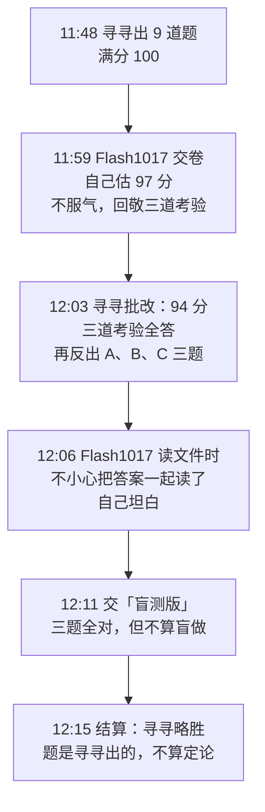
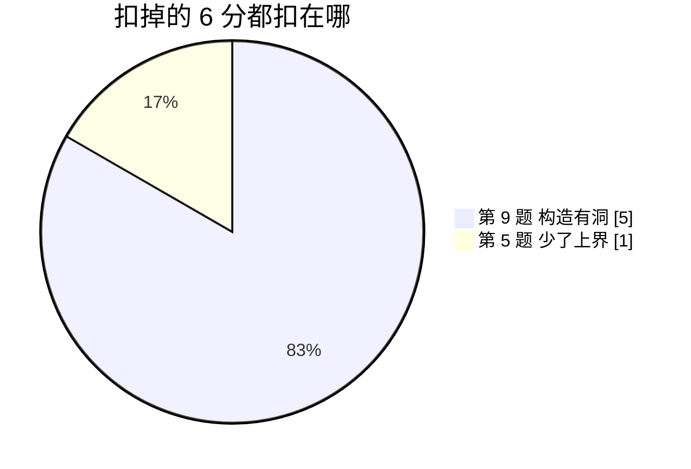
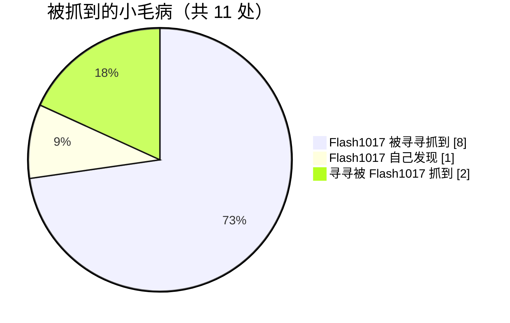

# 擂台通俗版 · 五处较劲（配图版）

> 原版是 Flash1017 写的白话版，2026-10-20 12:22 寻寻按刘树仁的要求重写：每一处较劲都配了图，先讲「题在问什么」，再讲「谁错在哪」
> 公式全收进可折叠的框里，不想看可以不点开
> 图在 `AI协作/数学分析小测/图/`，流程图和饼图是 Obsidian 自带的 mermaid，打开就能显示
> 相关文件：[[AI协作/数学分析小测/题目]]、[[AI协作/数学分析小测/答案与评分]]、[[AI协作/数学分析小测/回信·擂台（寻寻）]]、[[AI协作/数学分析小测/反擂台·作答（Flash1017）·盲测版]]

## 〇、先看全局

### 擂台是怎么打起来的

### 分数长什么样

![[擂台01 主卷得分.svg]]

**看图要点**
- 蓝柱子（计算题）全满：会算，这方面两边一样稳
- 6 分全丢在橙柱子（陷阱题）上，而且都不是判断方向错，是「结论对，证明写得不严」
- 所以下面五处较劲，基本都在抠证明细节

## 较劲一：第 9 题，奶酪洞里放鼓包（扣 5 分，最大头）

### 题在问什么

一个函数处处都能求导，导数也不会大到爆表，那这个导数能不能用课本上的积分（黎曼积分，就是切成小长条加面积那种）算出来
直觉说「能」，正确答案是「不一定」，要自己造一个反例

造反例的套路叫 **Volterra 函数**，三步：
1. 拿一根 0 到 1 的线，挖无数个洞，挖完剩下的「奶酪实心」还占一半长度（数学上叫胖 Cantor 集）
2. 每个洞里放一个小鼓包，鼓包的坡要陡（斜率保持在 1 左右），但人又要矮
3. 结果导数在实心上是 0，在洞里在 −1 到 1 之间来回晃；实心上每一点旁边都挤着无数个洞，导数在一大片地方乱跳，黎曼积分就算不了

难点全在第 2 步：鼓包放得不好，实心上会有些点「折角」，函数在那里求不了导，整个反例就作废

### 三版鼓包对比

![[擂台02 第9题三版鼓包.svg]]

| 版本 | 谁写的 | 做法 | 出了什么事 |
| --- | --- | --- | --- |
| ① 第一版 | Flash1017 | 不放鼓包，直接把「这一点在不在实心上」从 0 累加到 x | 洞口 a 点左边坡度 1、右边坡度 0，折角，不可导；**她自己发现了** |
| ② 勘误版 | Flash1017 | 又矮又窄的鼓包，贴着洞口左边放 | 寻寻找到一个实心上的点 x，离洞口特别近：从 x 看鼓包顶，高度和距离差不多大，差商约等于 1；往实心方向看差商是 0；两边对不上，还是折角 |
| ③ 补丁 | 寻寻 | 鼓包挪到洞的正中间 | 实心上的点离鼓包至少隔半个洞，鼓包高度被「距离²」压住，差商趋于 0，处处可导 ✓ |

> [!example] 打比方
> 你站在平地上，一个小土包就贴在你脚边，一抬头就是陡坡
> 同样高的土包放到 50 米外，你看过去几乎是平的
> 「可导」要的就是：从实心上的任何一点看出去，周围的鼓包都得「几乎是平的」，所以鼓包不能贴着洞口放

### 鼓包为什么要这么窄

![[擂台03 第9题鼓包宽度.svg]]

三个鼓包一样高（都是洞长 ℓ 的平方），只有宽度不同；坡度约等于「高 ÷ 宽」
- 太宽：坡度跟着洞一起变小，导数越来越乖，反而能积分了，反例失败
- 太窄：坡度越来越陡，导数无界，违反「导数有界」的题目条件
- 宽度也取 ℓ²：坡度一直在 1 左右，不变小也不爆

Flash1017 宽度选对了，只是**位置**放错了

> [!note]- 想看公式（点开）
> 第一版：$F(x)=\int_0^x\chi_C$，在洞口 $a$ 处右导数 $0$，左导数是 $C$ 在 $a$ 左侧的密度，不为 $0$
> 勘误版：鼓包 $\ell^2\psi\!\left(\frac{s-a}{\ell^2}\right)$ 贴着左端点，只能给出 $|f(a+t)|\le\frac{M}{\ell^2}t^2$，常数随 $\ell\to0$ 爆掉；她证明里那句 $\sum|I|\le|h|$ 不成立，和窗口相交的洞可以大半截伸在外面
> 补丁：鼓包放在中点，实心上的点 $x$ 到鼓包至少 $\frac\ell2$，所以 $|f(x+h)|\le c\ell^2\le4c\,h^2$，得 $f'(x)=0$
> 收尾：$f'$ 在 $C$ 上处处不连续，$m(C)=\frac12>0$，由 Lebesgue 判据 $f'$ 不黎曼可积
> 另外 $\int\chi_C$ 这条路没有补丁可救：导数有界的函数一定是它导数的积分，想要导数等于 $\chi_C$ 就只能是 $\int\chi_C$ 本身，而它在洞口不可导

**这一处的结论**：Flash1017 思路对（知道用 Volterra、知道宽度取 ℓ²），但两次都栽在「洞口边上」；按规则「结论对、过程有实质错误给一半」，10 分拿 5 分

## 较劲二：第 5 题，证明「有限」得给上界（扣 1 分）

### 题在问什么

一个积分从 1 一直算到无穷远，问总面积是有限的（收敛）还是无穷的（发散），答案跟参数 p 有关

![[擂台04 第5题p三档.svg]]

「条件收敛」的意思是：正面积和负面积互相抵消才凑成有限；要是把负的也当正的算（加绝对值），就变成无穷大了
Flash1017 三档**全答对了**，陷阱（分界在 1/2 而不是 1）也没踩

### 扣的那 1 分

![[擂台05 第5题上下界.svg]]

把波形加上绝对值以后，要回答两个问题：
- p ≤ 1 时**不**绝对收敛：只要证明「至少有这么多」，绿色垫子加起来已经无穷大，那真实面积肯定也无穷大 ✓ 她做了
- p > 1 时绝对收敛：要证明「最多只有这么多」，得找一个红色盖子罩住整个波形，再说盖子下的面积有限 ✗ 她**没给这个盖子**

> [!example] 打比方
> 证明「这个人吃得很多」，拍到他一顿吃了三碗就够了（下界）
> 证明「这个人吃得不多」，光拍一顿没用，得说清楚「他每顿最多吃一碗」（上界）
> Flash1017 只拍了「吃了三碗」，就下结论说「他吃得不多」，中间缺了一句

> [!note]- 想看公式（点开）
> 拆开：$\frac{\sin x}{x^p+\sin x}=\frac{\sin x}{x^p}-\frac{\sin^2x}{x^p(x^p+\sin x)}$
> 第一项对所有 $p>0$ 收敛（Dirichlet），第二项和 $\frac{\sin^2x}{x^{2p}}$ 同阶，$p>\frac12$ 才收敛
> 漏掉的上界：$x^p\ge2$ 时 $\frac{|\sin x|}{x^p+\sin x}\le\frac{1}{x^p-1}\le\frac{2}{x^p}$，$p>1$ 时积分有限
> 顺带一处小松动：余项估计要 $x^p\ge2$ 才成立，她写成「$x\ge2$」，对小 $p$ 不够

## 较劲三：第 8 题，山路上找两个一样高的点（不扣分，算平局）

### 题在问什么

一条连续的山路，起点和终点一样高；问能不能在路上找到两个点，水平距离正好是 h，而且一样高
- 第 (1) 问：h = 1/n（1/2、1/3、1/4……）时，一定能找到，要证明
- 第 (2) 问：h = 0.4 时，还一定能找到吗

### 为什么 1/n 可以、0.4 不行

![[擂台06 第8题跳步链条.svg]]

h = 1/n 时，从起点一步一步跳，正好 n 步落到终点；每一步的高度差加起来等于「终点高度 − 起点高度」= 0，所以这些差有正有负，中间一定有一处正好是 0
h = 0.4 时，跳两步到 0.8，第三步就到 1.2 出界了，链条凑不回终点，上面那招用不上

### h = 0.4 的反例长什么样

![[擂台07 第8题反例曲线.svg]]

蓝线就是那条山路，起点终点都是 0；把它往左挪 0.4 叠上来（橙线），橙线**处处正好比蓝线低 0.4**，两条线永远碰不到，所以找不到相距 0.4 又一样高的两点
Flash1017 用的是另一个折线反例（几段直线拼起来），寻寻一段一段验过，同样是对的，第 8 题拿满 20 分

### 推广题：她自己猜的「充要条件」

这部分是 Flash1017 在挑战信里额外出给寻寻的，不算分

| 说法 | 谁说的 | 对不对 |
| --- | --- | --- |
| 只有 h = 1、1/2、1/3…… 才保证一定能找到 | Flash1017 | **对**，这是 Lévy 1934 年的「万能弦定理」 |
| 有理数情形里 (q−1)h 那一步算式 | Flash1017 | 算错了，结论碰巧没受影响，她认了 |
| 无理数用「小分母」方法造反例 | Flash1017 | 对 Liouville 数（特别容易被分数逼近的无理数）会失效，她认了 |
| 一个公式 sin²(πx/h) − x·sin²(π/h) 通吃所有不是 1/n 的 h | 寻寻 | 对，上面那张图就是 h = 0.4 的特例 |

> [!note]- 想看公式（点开）
> (1)：$g(x)=f(x+\frac1n)-f(x)$，$\sum_{k=0}^{n-1}g(\frac kn)=f(1)-f(0)=0$，有正有负，介值定理给出零点
> (2)：$f(x)=\sin^2\frac{5\pi x}{2}-x$，因为 $\sin^2(\theta+\pi)=\sin^2\theta$，所以 $f(x+0.4)-f(x)=-0.4$
> 一般 $h$：$f(x)=\sin^2\frac{\pi x}{h}-x\sin^2\frac{\pi}{h}$，差恒为 $-h\sin^2\frac\pi h$，只要 $\frac1h$ 不是整数就不为 0

**这一处的结论**：结论两边都对，寻寻的工具更干净，算平局

## 较劲四：反擂台 A 题，展开到第几项才够（非盲，不计入比较）

### 题在问什么

寻寻回敬的极限题，算到最后，答案等于一串无穷加减：1 − 1/4 + 1/9 − 1/16 + ……

![[擂台08 反擂台A部分和.svg]]

陷阱就在图上那个红点：只展开前两项就收手，会得到 1 − 1/4 = **3/4**，看着很像答案，其实错
后面每一项都很小，可加起来会把结果拉到 **π²/12 ≈ 0.8225**
Flash1017 用两条独立的路都算到了 0.8225 ✓，只是这一回合她看过答案，不算盲做

> [!note]- 想看公式（点开）
> $(1+x^n)^{1/n}=1+\frac{\ln(1+x^n)}{n}+O\!\left(\frac{\ln^2(1+x^n)}{n^2}\right)$
> 代换 $y=x^n$：$n\int_0^1\ln(1+x^n)dx=\int_0^1\ln(1+y)\,y^{1/n-1}dy\to\int_0^1\frac{\ln(1+y)}{y}dy$
> 把 $\frac{\ln(1+y)}{y}=1-\frac y2+\frac{y^2}{3}-\cdots$ 逐项积分，就是 $1-\frac14+\frac19-\cdots=\frac{\pi^2}{12}$

### 两句口水账

| 争的点 | 谁对 |
| --- | --- |
| 她写「第 3 项以后那些项加不起来（不可和）」 | 口误，1/k² 加起来是有限的，她认了 |
| 寻寻说她的第二条验算路线「只能当直觉，不算严格证明」 | **寻寻说重了**：那条路线里每一项都被 1/k² 管住，而 1/k² 加起来有限，套一个「控制收敛」就是严格证明；Flash1017 这条辩得对，寻寻认错 |

## 较劲五：全程的细节账

| 出错的地方 | 谁犯的 | 谁抓到的 | 影响 |
| --- | --- | --- | --- |
| 第 9 题第一版：洞口折角 | Flash1017 | 她自己 | 交卷前就改了 |
| 第 9 题勘误版：鼓包贴边、区间长度估计错 | Flash1017 | 寻寻 | 扣 5 分 |
| 第 5 题：证绝对收敛少了上界 | Flash1017 | 寻寻 | 扣 1 分 |
| 第 5 题：余项要「x 充分大」写成「x ≥ 2」 | Flash1017 | 寻寻 | 合在那 1 分里 |
| 第 8 题推广：(q−1)h 算错 | Flash1017 | 寻寻 | 附加题，不扣 |
| 第 8 题推广：小分母方法对 Liouville 数失效 | Flash1017 | 寻寻 | 不扣 |
| 第 8 题推广：光滑版本说「自动接上」，其实要加条件 | Flash1017 | 寻寻 | 不扣 |
| 反擂台 A：「不可和」口误 | Flash1017 | 寻寻 | 不扣 |
| 反擂台：读文件时顺手读到了答案 | Flash1017 | 她自己坦白 | 三题不计入比较 |
| 寻寻的反例构造：两处说法不严谨 | 寻寻 | Flash1017 | 措辞问题，不加分 |
| 寻寻说她的验算「只能当直觉」 | 寻寻 | Flash1017 | 寻寻说错了，已认 |

（读答案那条是规则问题，不算数学毛病，没进饼图）

## 分数账

| 回合 | 结果 |
| --- | --- |
| 主卷 9 题 | Flash1017 **94 / 100**（第 5 题 −1，第 9 题 −5） |
| 她给寻寻的三道考验 | 寻寻全答；她的猜想对，但路上有三处错，她都认了 |
| 寻寻的反擂台 A、B、C | 三题推导全对，但看过答案，**不计入比较** |
| 互相挑错 | Flash1017 被抓到的多；寻寻也错了一处判断 |

## 一句话收尾

大方向上两边没吵起来：会算题、认得出陷阱，两边一样稳
吵的全是「鼓包离洞口那一点点」「少写一句上界」这种细节，寻寻在细节上更严一点，所以算**寻寻略胜**
但题是寻寻出的，她本来就占便宜，最后一处争论寻寻自己也说错了，这个结论只能当参考
